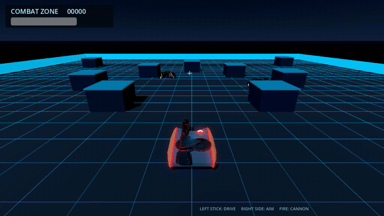
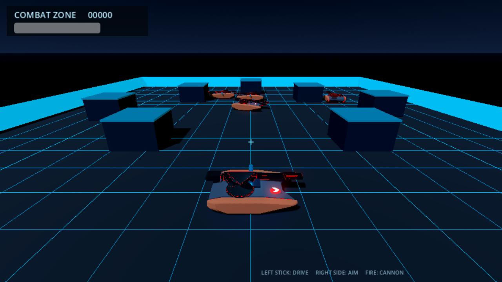
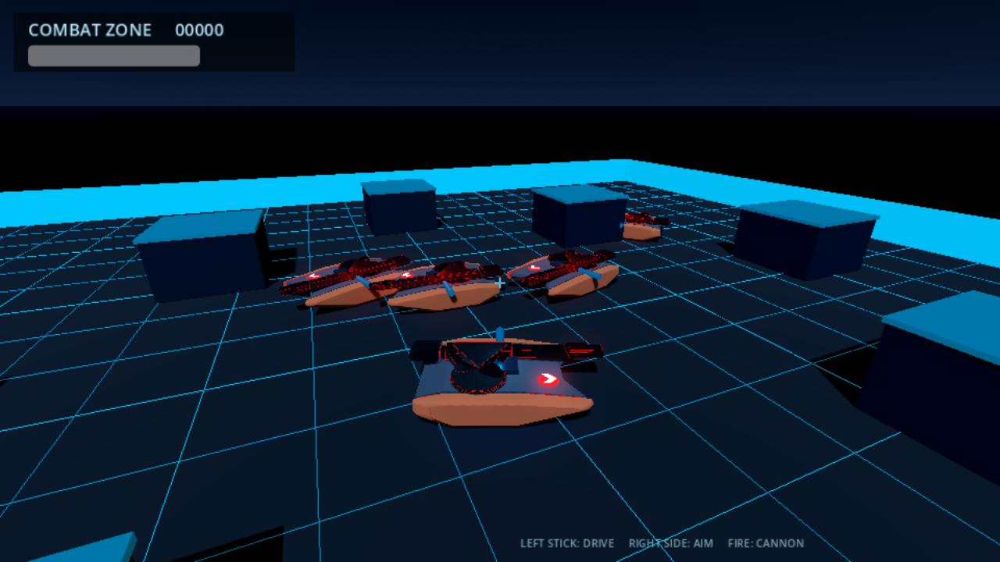

# Tron Tank Battle

A Godot 4 mobile-first tank combat prototype using the supplied Tron 1982 tank model. The battle takes place in a compact industrial arena with cover, slow cannon shells, enemy line-of-sight behavior, and a close follow camera.

## Gameplay

| The arena from spawn | Enemy tanks closing in |
| --- | --- |
|  |  |

## Controls

- Keyboard: **WASD** or arrows to drive, **Space** or click to fire, **R** to restart after destruction.
- Touch: hold the lower-left stick to drive and steer, drag on the right side to aim, and hold **FIRE** to shoot.

## Open and export

Open this folder in Godot 4.7 or later and run `scenes/battle.tscn`. The project targets the GL Compatibility renderer and enables ETC2/ASTC imports for Android. Android export uses the `Android` preset in `export_presets.cfg`; configure the Android SDK, JDK, export templates, and a release signing key in Godot before publishing.

The checked-in preset is for local debug builds. Its output path is `builds/tron-tank-battle-debug.apk`.

## Assets

The supplied Tron 1982 Tank model and its license are under `vendor/tron_1982_tank/`. Other supplied asset archives under `assets/` are not used by the current game and are excluded from Git.
